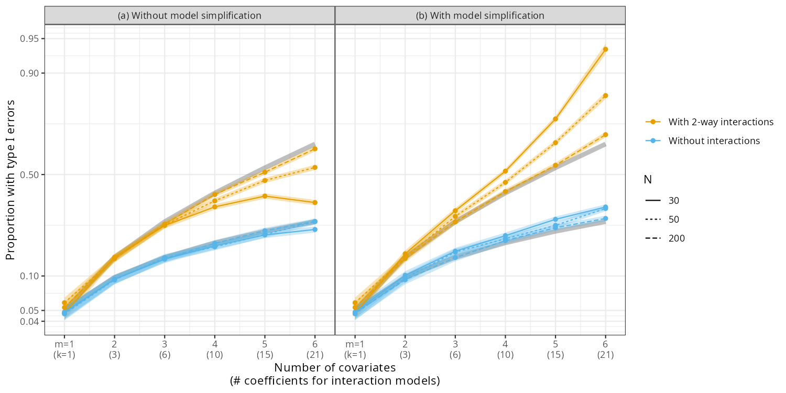
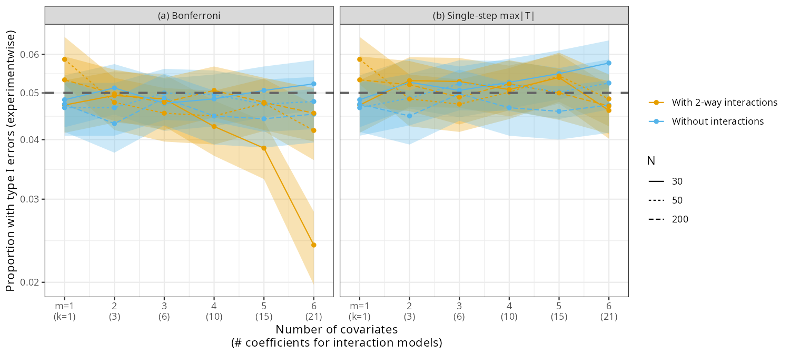
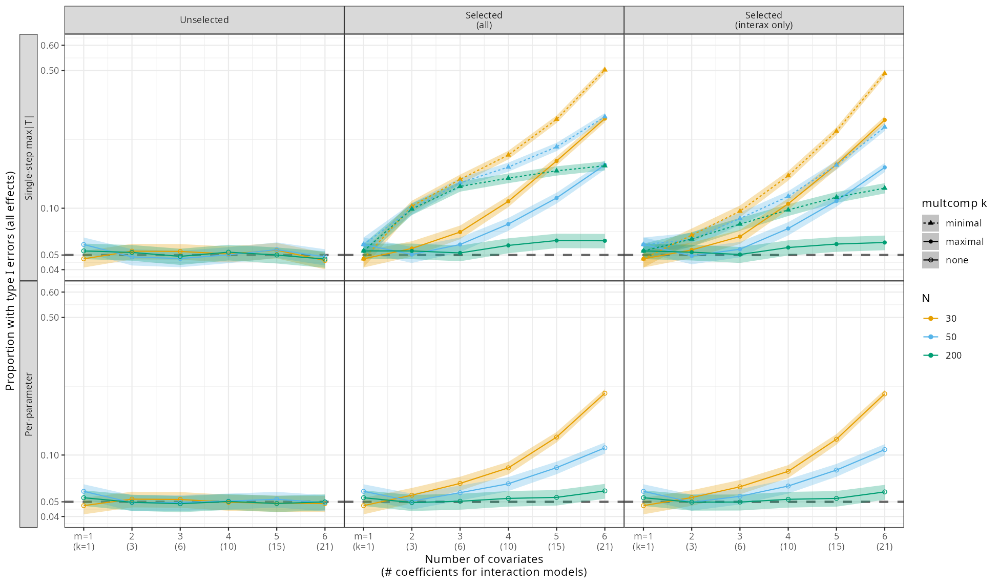
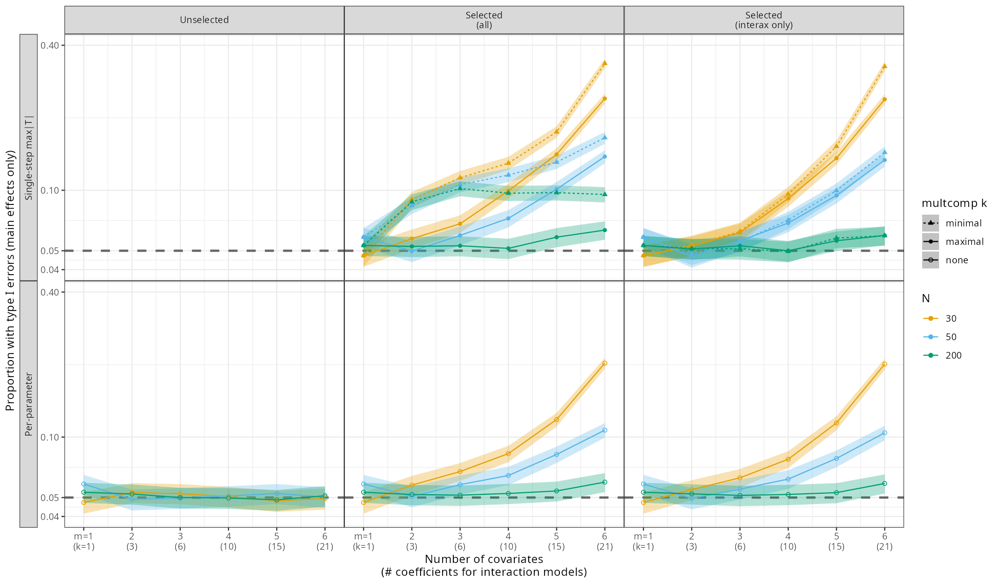

```{r setup, echo=FALSE, include = FALSE}
library("knitr")
knitr::opts_chunk$set(echo = FALSE)
```

This is a (Claude-assisted) exploration/extension of @forstmeierCryptic2011. F&S used linear regressions on null simulations (i.e., all effects equal to zero) to look at the effect of stepwise backward model selection on type I (false positive, experimentwise) error rates, estimated effect sizes and standard errors.

My main question was how the results would change if we limited the stepwise selection process only to interaction terms (i.e. always kept all main effects in the model). Most researchers have eventually accepted the idea that stepwise model selection/regression is a bad idea (@harrellProblemsStepwiseRegression1996, @whittinghamWhyWeStill2006, @flomStoppingStepwiseWhy2007, @mundryStepwiseModelFitting2009, @smithStepAwayStepwise2018 --- but see @murtaugh2009a for a counterargument in an ecological prediction context ...) However, some people still ask (and I have wondered myself) if model selection for *interactions* might work OK, if our main interest is in the fixed effects and the interactions are a nuisance term in the model.

So I ran simulations following @forstmeierCryptic2011's design, but considered the special case where we only allow dropping interactions, retaining all of the main effects in the model no matter what.
In addition, I explored how different multiple comparisons corrections, or looking at the estimate-wise rather than the experiment-wise error rate, might change the conclusions. (F&S do consider multiple comparisons corrections, but only the Bonferroni type.)

## replication

F&S simulated completely null cases (where all parameters were set to zero), with 1-6 input variables, and possibly including two-way interactions. They then tried fitting the models with and without stepwise simplification and computed the family-wise (or "experimentwise") error rate (FWER), i.e. the probability of making *any* type 1 errors.

@fig-fs-repro confirms that we can reconstruct F&S's Figure 1, with some minor changes (added $N=30$ as in F&S's Figure 3). The results are essentially the same, with slight differences probably due to the way that the experimental design was balanced. Without model simplification/selection, the experimentwise error rates are at or below [reasons discussed later] the expected null level (gray reference lines, $1-(1-\alpha)^k$, where $k$ is the number of coefficients tested, excluding the intercept); with model simplification, they're higher, especially in the models including two-way interactions.

```{r fig-fs-repro}
#| fig-cap: "Experimentwise error rates for a null regression simulation (nsim=5000), recreating Figure 1 from Forstmeier and Schielzeth."

```

## choice of multiple comparisons correction method

I was curious how well various multiple comparisons correction (MCC) approaches would work on unselected and selected data.

* **Bonferroni**: this is the most common approach to MCC. It controls the FWER below a specified $\alpha$ level, regardless of correlation among hypotheses or the true proportion of null hypotheses. It's also very easy to implement (reject only if [$p<\alpha/k$)]{style="white-space: nowrap;"}
* **Holm** (or "Holm-Bonferroni" or "sequentially rejective Bonferroni test") is the usually recommended less-conservative alternative to Bonferroni: it is robust to correlation, and uniformly more powerful than Bonferroni. 
* the **Dunn-Šidák** correction solves the equation $p = 1-(1-\alpha)^k$ to get an $\alpha$ value that will give correct error rates for $k$ uncorrelated tests (it converges to Bonferroni for small $\alpha$).
* **Single-step max|T|**: this correction takes the exact correlations from the linear tests into account; it is equivalent to `adjust="mvt"` in `emmeans`, and gets back exactly to the nominal $\alpha$ value in the unselected case.

For this particular simulation setup, however, with $\alpha \ll 1$ and all of the effects in the model null (i.e., all of the null hypotheses being tested are true), the first three approaches (Bonferroni, Holm, Dunn-Šidák) give nearly identical results.

```{r fig-corrections}
#| fig-cap: "Experimentwise error rates using various multiple comparisons corrections methods (no model selection)."

```

Because the tests are correlated in this case, the Bonferroni (and Dunn-Šidák and Holm) results are conservative, but only visibly so for $N=30$, $k=21$. (Remember that these procedures are intended to control the FWER *below* a specified $\alpha$ level ...) The single-step max-T always gives close to the nominal FWER (its only disadvantages are that it's computationally expensive, and specific to linear models).

## interaction focus

For the remainder of this piece, I'm only going to look at the "with 2-way interactions" case, since I'm primarily interested in how interactions are handled.

I added a new form of stepwise selection (using the `scope` argument in `step`) that only tries to drop interaction terms (note that `step()` uses AIC, not $p$-values, to decide which terms to drop), leaving all main effects intact. I ran all of the different MC approaches, but only show max-\|T\| in the results below (since it gives the best results for the unselected case). 

* I computed the correction either with the original, 'maximal' $k$ (number of comparisons) [as F&S did], or with a naive $k$ ('minimal') based on the number of parameters remaining in the selected model
* I also computed per-parameter (estimate) rather than experiment-wise error rates (no MC needed)
* I counted errors either in all estimates (main effects and interactions) or in the main effects only

The 'minimal-$k$' or per-parameter error rates are meant to mimic the approach of a well-meaning but naive analyst ...

```{r fig-scenarios-all}
#| fig-cap: "Error rates under different scenarios: all estimates"

```

```{r fig-scenarios-mainonly}
#| fig-cap: "Error rates under different scenarios: main-effect estimates only"

```

## conclusions

* **Restricting `step()` to discard only interactions (never main effects) barely reduces the type I error inflation.** Across the `selected (all)` vs. `selected (interax only)` scenarios (uncorrected rates, not shown; compare the two 'Selected' columns of @fig-scenarios-all for the same pattern with max-\|T\| and per-parameter rates), the restricted version is slightly lower than the unrestricted one in essentially every with-interactions condition (the two are identical for $m=1$, where there are no interactions to drop). The gap is small relative to the inflation itself: at most about 3 percentage points (at $N=30$, $k=10$: 0.49 vs. 0.52), and only 2 points at $N=50$, $k=21$ (0.83 vs. 0.85). Most of the "cryptic multiple testing" problem comes from having many interaction terms available to prune in the first place, not from the additional freedom to also drop main effects.
* **Calibrating a correction on the selected model's own surviving terms
[("minimal" $k$)]{style="white-space: nowrap;"} substantially undercorrects relative to calibrating on
the pre-selection full model ("maximal" $k$, the paper's Fig. 3b
approach)** (dotted vs. solid lines in @fig-scenarios-all). At $N=50$, $k$=21 (selected-all scenario), minimal-$k$ Dunn-Šidák/Holm/max-\|T\| all still show $\approx$ 0.31-0.32 type I error, while
maximal-$k$ brings them down to $\approx$ 0.18-0.19 -- both well above nominal
0.05, but maximal is roughly half the inflation of minimal. The gap
between the two calibrations grows with $N/k$, and even the "correct" maximal-$k$ calibration leaves substantial residual inflation at low $N$ relative to $k$, matching the paper's own finding that $P$-value adjustment on the minimal model doesn't fully solve the problem when the initial full model is (a) overfitted and (b) selected.
* **testing only main effects helps, but doesn't fix the problem at low $N$ relative to $k$** (@fig-scenarios-mainonly vs. @fig-scenarios-all). (Here we compute the maximal $k$ as the number of main effects, since we're not going to consider interaction terms at all.) The per-parameter error rates are essentially the same for main effects as for all effects. For max-\|T\| after unrestricted selection, maximal-$k$ calibration is always at or below minimal-$k$, and both are lower than when all effects are tested: at $N=50$, $k=21$, 0.14 (maximal) and 0.18 (minimal) for main effects, vs. 0.18 and 0.32 for all effects. At $N=200$ the main-effects rate with maximal $k$ is close to nominal (0.06), but at $N=30$ it is still 0.26. When selection only drops interactions, minimal and maximal $k$ are both $m$, and the two calibrations give nearly the same rates.

## references
